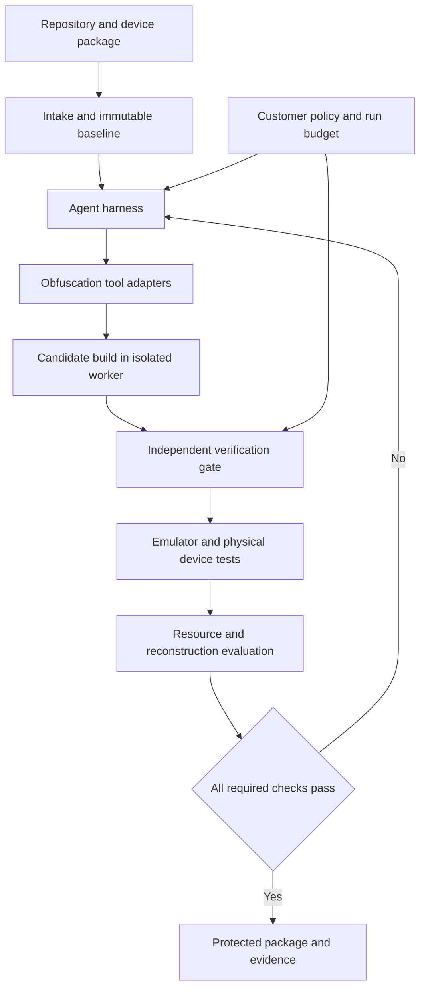

# Instructions for autonomous implementation

Implement the Mirage proof of concept through all first-release milestones without asking the user implementation questions.

When a question arises, record it in the implementation decision log. Choose the most reasonable option and continue immediately.

Use this decision order: explicit user requirements, verified existing project conventions, documented defaults, then the simplest reversible choice.

The user will review unresolved questions and assumptions after implementation. Do not wait for that review.

Treat normal design choices, dependency choices, interface wording, and implementation details as delegated decisions.

Do not stop after a plan, one milestone, one failed candidate, or one unavailable optional integration.

Preserve existing work. Keep the new platform separate from unrelated projects and the earlier image prototype.

Keep correctness checks independent. Do not weaken a proof obligation, change the reference behavior, or fabricate evidence to avoid a blocker.

If an external action lacks required access or authorization, record the dependency and continue all available work. Do not bypass that boundary.

Use only already authorized services within their configured limits. Missing access must not become an interactive setup request.

Separate real execution, recorded execution, and test fixtures in the interface and reports.

Before ending, run all available acceptance checks and verify the browser workflow. Repair failures that the current environment permits.

Finish with runnable instructions, evidence, the decision log, and a short list of unresolved dependencies. State incomplete acceptance checks explicitly.

# Product purpose and customer

Mirage helps consumer-electronics companies protect proprietary firmware algorithms while preserving device behavior and resource limits.

The customer supplies a repository, a target device profile, and acceptance requirements. An agent then searches for obfuscation transformations inside an isolated build environment. Independent tools evaluate each candidate. Mirage returns a reproducible protected build with its evidence.

The first customer group is firmware teams with valuable algorithms that must execute on customer-owned devices. Examples include sensor processing, motion planning, signal processing, calibration, and proprietary control calculations.

The buyer hypothesis is an engineering leader responsible for firmware and intellectual property. Firmware engineers operate the product. Verification engineers review correctness evidence.

The product objective is to increase the measured effort needed to reconstruct protected algorithms. The product must preserve observable behavior within the customer's declared contract.

The first demonstration is a fictional sensor-calibration calculator. The earlier image generator remains a separate prototype. Neither example limits the product's application scope.

Status: autonomous implementation requirements dated 8 November 2026. The user delegates routine decisions to the implementing agent. Record questions, choose reasonable defaults, and continue. Review assumptions after implementation.

# Product scope and release decisions

## Confirmed direction

- Provide an agent harness with obfuscation, build, verification, and evaluation tools.

- Accept a GitHub repository link as the main onboarding entry.

- Let customers select a processor architecture and a specific device profile.

- Accept custom hardware descriptions and supporting design files.

- Adapt protection to the selected device's resource and behavior requirements.

- Support consumer-electronics firmware as the initial market.

- Preserve a path toward other software categories through target adapters.

## First implementation

Build a small C sensor-calibration calculator for Linux x86-64. Use a native executable to avoid a board emulator in the first demonstration. Protect one bounded calculation function. Preserve the input parser and application interface.

Implement the target as an adapter from the start. Add microcontroller and embedded-Linux adapters later without changing the project, policy, candidate, or evidence contracts.

Whole-device support means building and testing the complete firmware image. It does not imply a formal proof of every device behavior.

## Selected scope and engineering defaults

| Decision | Selection | Basis |
|---|---|---|
| Delivery | One working proof of concept and its frontend | User requirement |
| Example product | Fictional sensor-calibration calculator | Engineering default |
| Initial target | Linux x86-64 with a C toolchain | Least-integration default |
| Execution | Hosted isolated sandbox | User requirement |
| External models | Approved models can inspect source | User authorization for this design |
| Outputs | Changed source and a deployable target package | User requirement |
| Device model | Assess resources and benefit before inclusion | User requirement |
| Custom hardware | Versioned upload and capability interface from the first release | User requirement |
| Formal checking | Prove the supported changed function against the original | Engineering default |
| Physical hardware | Later adapter and validation stage | Proof-of-concept scope |

The first deployable package contains a Linux executable. Firmware image packaging becomes available when a firmware target adapter exists. The frontend must state this distinction.

## Initial exclusions

The first release executes the sample C project on Linux x86-64. It imports custom profiles and reports capability gaps. It does not claim to execute unknown hardware or prove arbitrary programs.

Initially exclude transformations inside interrupt handlers, bootloaders, safety interlocks, cryptographic primitives, and timing-critical peripheral drivers. The fictional sample uses the listed exclusions without further user input. Future customers can add exclusions.

Later support for these regions requires separate validation and target-specific acceptance criteria.

# Customer workflow

1. Connect a public repository or select the included sample project.

2. Select a commit, build configuration, and dependency sources.

3. Choose a supported device or upload a custom device package.

4. Confirm the detected target and its support status.

5. Select valuable functions or approve the agent's proposed selection.

6. Set correctness, memory, timing, energy, and build-cost limits.

7. Run the original build and establish baseline evidence.

8. Start the bounded protection search.

9. Review accepted candidates and rejected transformation reasons.

10. Download changed source, the executable package, and evidence.

11. Run the package on its declared target.

The interface must show missing requirements before an expensive run starts. A repository link alone can start discovery. Missing toolchains, board models, tests, or credentials can prevent a valid build.

The first release supports run cancellation and durable job status. Worker recovery preserves completed evidence. Pause and resume are later workflow features.

The product can later create a proposed source branch through a separate repository permission. It must not silently merge code or publish firmware.

## Main screens

| Screen | Required interaction |
|---|---|
| Project intake | Paste a repository URL or choose the sample |
| Target setup | Choose Linux x86-64 or upload a custom profile |
| Product specification | Enter memory, execution, size, and optional energy limits |
| Protection setup | Select the protected function, exclusions, model policy, and run budget |
| Run view | Watch actual tool events, failures, proof results, and resource use |
| Candidate view | Compare source changes, binary identity, measured costs, and evidence |
| Live calculator | Send fresh inputs to both original and accepted executables |
| Result download | Retrieve changed source, executable package, manifest, and reports |

The sample path must work without a customer repository. Public GitHub import is supported first. Private repository authorization is a later connector.

Unsupported hardware remains selectable for profile intake. Its run action must explain which target capabilities are missing.

The interface must show a real failed candidate and a later accepted candidate. Recorded events must carry a replay label when replayed.

Progress must identify the active tool and completed checks. The interface must distinguish a failed candidate from a failed infrastructure job.

A result must state which functions changed, which checks passed, and which claims remain unsupported.

# System architecture

Mirage separates orchestration, transformation, verification, and device execution.



| Component | Responsibility |
|---|---|
| Project interface | Collect repository, device, policy, and run requirements |
| Repository connector | Resolve commits and retrieve authorized source and dependencies |
| Profile registry | Store versioned device, toolchain, emulator, and verification capabilities |
| Workflow engine | Schedule durable jobs, retries, cancellation, and budget enforcement |
| Agent harness | Choose transformations and interpret tool feedback |
| Transformation adapters | Apply supported source, compiler, or bytecode transformations |
| Verification service | Evaluate candidates against the frozen contract |
| Execution adapters | Run native tests, device emulators, and customer hardware benches |
| Evaluation service | Measure resource costs and reconstruction outcomes |
| Evidence store | Preserve artifacts, identities, logs, and verification scope |
| Packaging service | Produce the final customer-specific release package |

The agent proposes actions. A deterministic policy gate decides whether a candidate is acceptable.

## Three distinct execution environments

A build sandbox isolates repository builds and tool execution.

A device emulator models the target processor, memory, and peripherals.

An optional obfuscation interpreter executes protected code inside the shipped firmware.

These environments serve different purposes. A customer can use Mirage without shipping the build sandbox or device emulator.

## First implementation structure

Use a TypeScript frontend and Node.js services. A single hosted worker is sufficient for the first demonstration. Use a durable job table and an append-only event log.

Store metadata in SQLite on persistent storage for the single-worker deployment. Keep the storage interface replaceable for PostgreSQL. Store artifacts in a private content-addressed directory.

Use ephemeral virtual machines or a managed sandbox for repository execution. A container can pin tools inside that boundary. A local subprocess alone does not satisfy hosted isolation.

The first sandbox contains a pinned C compiler, CBMC, build tools, and a debugger. The exact image digest enters every run manifest.

Keep verification workers separate from agent write permissions. Place physical device access behind a customer-controlled runner.

Use separate packages for the frontend, service, workflow, schemas, tool adapters, target adapters, and sample project.

Keep the large agent model behind a provider interface. Select its identifier through configuration. Do not hard-code provider response text into workflow decisions.

The first implementation must test compatibility among the pinned compiler, CBMC version, and sample language subset before expanding transformations.

# Device profiles and custom hardware

The target selector must describe a processor and a board, not only a vendor name. Architecture choices can include x86-64, ARM variants, and RISC-V variants.

The complete target also needs its application binary interface, operating environment, toolchain, memory layout, and peripherals. QEMU's documentation explicitly requires board selection for ARM system emulation. [QEMU ARM system documentation](https://www.qemu.org/docs/master/system/target-arm.html)

## Versioned device package

| Field group | Required content |
|---|---|
| Identity | Device name, board revision, processor part, profile version, content hash |
| Processor | Architecture, instruction extensions, byte order, word size, floating-point behavior |
| Software environment | Bare metal or operating system, scheduler, compiler, linker, build commands |
| Memory | Flash regions, random-access memory regions, stack limits, alignment, execution permissions |
| Peripherals | Register maps, buses, interrupts, timers, watchdogs, direct memory access, external components |
| Startup and updates | Boot configuration, linker script, image format, update layout, signing handoff |
| Verification | Contracts, models, test entry points, environmental assumptions, excluded code |
| Resource policy | Absolute memory limits, execution deadlines, energy constraints, allowed overhead |
| Execution | Emulator adapter, peripheral model versions, sensor traces, hardware runner identifier |

The first version uses a documented JSON device-profile schema. Validate required fields and units at upload. Unknown fields block dependent checks and cannot receive invented defaults.

## Upload support

The first version accepts its own JSON device profile and supporting files. Device-tree, linker-script, register-description, and vendor-file extraction are later adapters. Uploaded files remain available for review.

Accept schematics, board layouts, bills of materials, and datasheets as supporting attachments. The first version does not promise automatic extraction from them. Later extraction requires provenance and review.

Zephyr uses device-tree sources, includes, overlays, and bindings to describe hardware configuration. These files provide structured inputs for an adapter. [Zephyr device-tree inputs](https://docs.zephyrproject.org/latest/build/dts/intro-input-output.html)

Renode platform files connect processor and peripheral models. Custom peripheral behavior can require model code. [Renode platform descriptions](https://renode.readthedocs.io/en/latest/basic/describing_platforms.html), [Renode peripheral modeling](https://renode.readthedocs.io/en/latest/advanced/writing-peripherals.html)

Therefore, Mirage must treat hardware description and hardware behavior as separate inputs. A schematic alone does not establish a complete executable model.

## Support states

Profiles track separate capabilities for build, execution, formal checking, resource measurement, and hardware validation. The initial Linux adapter supports native execution. Imported custom profiles remain unsupported until an adapter satisfies their requirements.

An unsupported peripheral must produce an explicit capability gap. Mirage must not interpret a silent peripheral stub as verified device behavior.

Physical behavior tests require a bench fixture, sensor inputs, actuator limits, reset procedure, and recovery procedure. The customer configures these before remote execution.

For a toothbrush, the contract can include motor commands and pressure-response behavior. For a cleaning robot, it can include navigation outputs and actuator deadlines.

These are example contracts for later device adapters. The proof of concept uses a fictional calculator and does not claim validation on either device.

## Minimum device profile contract

The JSON schema includes a version, target identifier, architecture, operating environment, toolchain reference, resource limits, model policy, and supporting file references.

Resource fields use explicit units: bytes, microseconds, megahertz, and millijoules where applicable. Missing measurements remain unknown.

The model policy supports disabled, automatic assessment, and required modes. Required mode fails clearly when the selected device cannot satisfy the model contract.

Each target adapter exposes capabilities, baseline build, candidate build, execution, measurement, and packaging. Verification adapters remain independent of target adapters.

A later hardware adapter can add emulator execution and physical-device execution. The service must not need a new candidate or evidence format for that addition.

# Agent tools and iteration loop

## Tool contract

Every tool request includes project identity, immutable input hashes, target profile version, and a resource budget. Every response includes a typed result, logs, output hashes, duration, and failure classification.

The first tools inspect the repository, build the baseline, identify the protected function, apply transformations, run CBMC, compare outputs, measure execution, and package results. Emulator and physical-device tools are reserved adapter contracts.

Transformation tools must declare their supported language features, target constraints, proof obligations, and expected resource effects.

## Search sequence

1. Verify the original build and freeze its accepted contract.

2. Classify candidate functions and unsupported features.

3. Select algebraic rewriting, constant encoding, or bounded control-flow restructuring.

4. Apply it in a separate candidate workspace.

5. Compile with the pinned toolchain.

6. Run static checks and the required equivalence checks.

7. Reject incorrect or inconclusive candidates under the strict policy.

8. Run the target adapter's required execution and integration checks.

9. Measure memory, execution time, and other required resources.

10. Run resistance checks within the remaining evaluation budget.

11. Retain accepted candidates and record rejected candidates.

12. Continue until the stopping condition applies.

The agent can repair candidate code. It cannot edit the frozen baseline, remove required tests, weaken assertions, or change acceptance thresholds.

Contract changes create a new policy version and invalidate affected evidence. The implementing agent records justified demonstration-default changes without waiting for user review. The Mirage runtime agent cannot alter its frozen contract.

## Candidate selection

Correctness and device limits are hard constraints. Protection improvement is optimized only among candidates that meet those constraints.

Retain candidates that offer different tradeoffs between resistance, memory, timing, and build cost. Show those tradeoffs to the customer.

Stop at the candidate, time, model-cost, or repeated-failure limit. Cancellation terminates active sandbox work. Return the best accepted candidate and the reason for stopping.

A run that finds no acceptable transformation must return the unchanged baseline and a clear outcome. It must not label that output as improved protection.

## Small model roles

A build-time model can propose private transformation patterns or generate constrained code. Its output still passes the same independent verification gates.

An optional device model can generate runtime decoys or participate in instruction decoding. The model requires independent correctness, resource, and resistance evidence.

The first release must implement model-placement assessment. It must not require an on-device model to complete the demonstration.

Assess available memory, storage, processor features, execution deadlines, startup time, and measured inference cost. Include model weights, inference buffers, generated code, and interpreter cost.

A model that fits the device is eligible for evaluation. Include it automatically only when all required checks pass and the evaluation shows a protection benefit.

When measurements are missing, report that the decision is unresolved. When a runtime model adapter is absent, report that implementation is unavailable.

The product specification can permit additional memory or compute. Report the required increase and the measured benefit before recommending that device change.

The service does not purchase hardware or change the customer's bill of materials automatically.

Private build infrastructure can protect unpublished pattern catalogs. The threat model must assume attackers can inspect distributed firmware and distributed model weights.

Pattern secrecy is not a substitute for measured reconstruction resistance.

# Correctness verification

Correctness means preservation of the declared observable behavior under the declared environment assumptions.

The contract can cover return values, persistent state, memory effects, peripheral accesses, output ordering, faults, and deadlines. Numerical tolerance requires an explicit customer-approved rule.

## Verification layers

| Layer | Purpose | Required evidence |
|---|---|---|
| Baseline validation | Establish that the original builds and passes its accepted checks | Source identity, toolchain, tests, known failures |
| Transformation validation | Check behavior preservation for changed regions | Proof scope, assumptions, solver output, counterexamples |
| Differential testing | Compare original and candidate on matching inputs | Input corpus, seeds, outputs, coverage |
| Firmware integration | Check unchanged interfaces and complete image behavior | Integration results and target configuration |
| Device validation | Check required behavior and resource limits on hardware | Board revision, instrumentation, traces, measurement conditions |
| Artifact validation | Link accepted evidence to the released binary | Artifact hashes, build provenance, packaging records |

Alive2 can validate supported LLVM intermediate-representation transformations. It does not support interprocedural transformations. Therefore, it cannot serve as a universal firmware equivalence checker. [Alive2 documentation](https://github.com/AliveToolkit/alive2)

CBMC can check C program properties with a verification harness. Complete claims require adequate loop bounds and applicable assumptions. Bounded exploration alone does not prove unrestricted behavior. [CBMC tutorial](https://diffblue.github.io/cbmc/cprover-manual/md_cbmc-tutorial.html)

Use CBMC as the first proof adapter for the bounded C function. Keep Alive2 as a later adapter. Do not implement multiple proof engines before the first complete workflow works.

## Evidence states

Each obligation returns one of: proved within stated assumptions, counterexample found, bounded checks passed, tests passed, unsupported, timeout, or tool error.

Only the first state satisfies a required formal proof. A timeout or unsupported feature is never a successful proof.

Record the input domain, loop bounds, memory model, library models, assumptions, tool versions, and proof logs. Identify the components outside the proof boundary.

Proofs at source or intermediate representation do not automatically cover compiler backends, linking, packaging, or physical timing. The report must state those trusted components and remaining checks.

Baseline undefined behavior must become an explicit blocker or a separate repair task. The agent must not use undefined behavior to obtain an empty correctness claim.

## Gate protection

Use the original accepted contract for every candidate. Give the agent read access to failures and counterexamples, but no write access to gate configuration.

Keep final evaluation inputs separate from search inputs. Preserve a candidate's source and binary identities before final evaluation.

The first strict policy leaves unsupported regions unchanged. A future experimental policy can export test-only candidates with an explicit nonproduction status.

## Demonstration contract

The protected function is a fictional calibration calculation. It accepts an unsigned sensor reading, an unsigned fixed-point gain, and a signed offset.

The reading ranges from 0 to 4095. The gain ranges from 1 to 1024. The offset ranges from minus 1024 to 1024.

The gain uses eight fractional bits. A gain of 256 represents multiplication by one.

Compute the result with the following exact definition:

```c
uint16_t calibrate(uint16_t raw, uint16_t gain_q8, int16_t offset) {
    uint32_t scaled = ((uint32_t)raw * (uint32_t)gain_q8 + 128u) >> 8;
    int32_t shifted = (int32_t)scaled + (int32_t)offset;
    if (shifted < 0) return 0;
    if (shifted > 4095) return 4095;
    return (uint16_t)shifted;
}
```

The function contract covers only the declared input ranges. The application rejects malformed or out-of-range inputs before invocation.

Reference cases include `(1000, 256, -10) = 990`, `(1, 128, 0) = 1`, and `(4095, 1024, 1024) = 4095`.

Use fixed-width integer types and explicitly defined intermediate arithmetic. Keep file access, parsing, networking, floating-point operations, and device peripherals outside this first proof.

Construct a relational CBMC harness that invokes original and candidate functions on the same symbolic inputs. Assert equal results over the complete declared domain.

Also check relevant arithmetic and memory properties. Record the supported compiler assumptions. A proof timeout rejects that candidate under the strict policy. It does not stop the implementing agent from trying another candidate or completing independent work.

The final executable must pass differential checks against the original executable. Source equivalence does not alone prove the compiler backend correct.

# Protection evaluation

Protection means increased reconstruction effort under a defined attacker model.

Assume the analyst can obtain the release executable and inspect its distributed runtime components. The demonstration permits disassembly, debugging, execution, and tracing. Later device profiles specify any physical access limits.

A separate benchmark can measure attacks that require source or build access. Do not combine those results with shipped-firmware attacks.

## Required comparisons

Compare the original release build, an ordinary procedural obfuscation baseline, and the proposed agent-selected result. Add neural variants only when implemented.

Use equivalent tools, time, compute, and query budgets. Record every completed attempt and every failure. Separate changes to build identity or attacker configuration.

Give the reconstruction evaluator the shipped artifact and the permitted observations. Do not give it private source, transformation logs, or held-out test answers.

Freeze reconstructed implementations before final evaluation. Require independent execution without the protected runtime when the task is algorithm reconstruction.

## Measurements

- Correct reconstruction rate on held-out inputs.

- Time and tool budget needed for successful reconstruction.

- Recovered code coverage and recovered algorithm components.

- Success of tracing, simplification, and runtime removal.

- Timing, memory, energy, and firmware-size costs.

- Build time and total protection-run cost.

Report time limits as censored attempts. A failed attempt within one budget does not establish permanent protection.

Static complexity scores can guide search. They cannot alone establish that copying the algorithm is harder.

The demonstration succeeds operationally when its complete agent-and-verification workflow works. A protection-improvement claim requires a separate positive reconstruction result.

Use one fixed configuration and budget per target for the first demonstration. Allow five minutes and twenty thousand model tokens per reconstruction attempt.

Compare original, procedural-baseline, and agent-selected builds. Freeze the selected build before final analysis. Record the exact model and tools.

Generate one thousand final input cases after freezing reconstructed programs. Record the selection seed and include boundary inputs separately.

These are initial experiment settings. They are not statistically sufficient evidence of broad protection.

Ensure transformations remain present in the optimized release binary. A source change removed by the compiler cannot count as shipped obfuscation.

The existing image prototype demonstrates code replacement and output equality. Its trace exposes real instructions. It does not establish a protection advantage.

# Build outputs and evidence

Each accepted result includes changed source, a patch, the target executable package, a machine-readable manifest, and a human-readable evidence report. Future firmware adapters replace executable packaging with their declared firmware image format.

The evidence package contains source revision, dependency identities, target profile, compiler settings, transformation history, proof scope, test results, resource measurements, and reconstruction results.

Store model identifiers, generation settings, seeds, and weight hashes when a model affects a build.

Keep private source, symbols, transformation explanations, and proof inputs separate from the customer-distributed firmware. They can reveal the protected implementation.

The manifest links every check to the exact candidate and final binary hashes. Packaging changes invalidate relevant artifact checks.

The customer controls production signing keys. Mirage integrates with the customer's signing process without requiring the agent to receive those keys.

Provide source archives and patches in the first release. Private symbols and proof materials stay in a separate developer bundle. Pull requests, firmware flashing, and production deployment are later authorized integrations.

## Core records

| Record | Main fields |
|---|---|
| Project | Owner, repository, access policy, retention policy |
| Source snapshot | Commit, dependencies, source hash, build configuration |
| Device profile | Architecture, board revision, memory map, peripheral models, toolchain |
| Protection policy | Protected regions, exclusions, proof requirements, resource limits, run budget |
| Candidate | Parent candidate, transformations, source hash, binary hash, status |
| Verification result | Candidate, obligation, assumptions, tool version, result, evidence references |
| Measurement | Candidate, device, workload, metric, units, samples, instrumentation |
| Reconstruction attempt | Artifact hash, analyst configuration, budget, transcript, frozen output, score |
| Release package | Candidate, binary, manifest, reports, signing handoff status |

Worker actions must be idempotent against these immutable identities. Retrying a tool must not overwrite evidence from another candidate.

## Service interface

The first service supports project creation, profile validation, run creation, run inspection, event streaming, cancellation, candidate inspection, and artifact download.

Use typed request and response schemas. Every mutation carries an idempotency key. Every event carries run identity, sequence, timestamp, stage, and evidence references.

Run states are queued, preparing, baseline, searching, verifying, evaluating, packaging, succeeded, failed, and cancelled.

Proof states remain independent from run states. A successful workflow cannot silently promote a test-only result into a formal proof.

Artifacts require project-scoped authorization. Downloads must resolve recorded artifact identifiers rather than arbitrary filesystem paths.

The first public repository connector accepts HTTPS GitHub repository URLs. It resolves the selected revision before sandbox execution.

Reject unsupported hosts, local-network destinations, path escapes, oversized downloads, and archive traversal. Treat repository build instructions as untrusted inputs.

# Data isolation and deployment

Customer source code, device designs, and proprietary algorithms are sensitive product inputs.

The selected product deployment is a hosted cloud sandbox. Approved external agent models may inspect source. A customer-controlled deployment remains a later option.

The first deployment supports one authenticated demonstration workspace and one active job. It must isolate repository execution from the service and its credentials. Multi-customer operation requires a later isolation review.

External model access must follow the project's explicit source-disclosure policy. A local worker does not preserve source privacy if it sends source to an external model.

Repository scripts, dependencies, uploaded models, and hardware packages are untrusted execution inputs. Run them inside the approved isolation boundary.

Do not provide worker jobs with unrelated customer data, host credentials, unrestricted hardware access, or production signing keys.

Use separate storage access for the agent, verifier, and release exporter. Preserve audit records for artifact reads, tool execution, policy changes, and release actions.

The demonstration retains artifacts for seven days unless the operator deletes them earlier. Preserve explicitly exported evidence. Treat this as an initial configurable retention policy.

The initial product must make no training use of customer source by default.

## Operational behavior

Runs need cancellation, bounded retries, checkpoints, worker recovery, and explicit cost limits. Network or worker failure must not convert missing checks into passing checks.

Physical-device jobs need exclusive device access and a reset procedure. Reconnection must confirm device identity and firmware identity.

Stop a physical test when its configured actuator or electrical limits are exceeded. Preserve the failure evidence for review.

# Requirements and acceptance criteria

| Requirement | Acceptance condition |
|---|---|
| Repository intake | A selected commit produces an immutable source snapshot and a dependency inventory |
| Reproducible baseline | A clean worker reproduces the baseline under the declared environment |
| Device intake | The system validates required fields and lists unsupported hardware behavior |
| Custom hardware files | Every imported profile field retains its source and review state |
| Bounded agent loop | The run stops at its cost, time, or iteration limit |
| Gate independence | The agent cannot modify frozen contracts or required checks |
| Incorrect candidate rejection | An injected behavior change fails the appropriate verification obligation |
| Proof completeness reporting | A timeout, missing model, or incomplete bound cannot receive a proof-success label |
| Device limits | Every accepted candidate satisfies all required absolute limits |
| Evidence identity | Every report points to the exact source, profile, toolchain, and binary hashes |
| Reproducible transformation | The same inputs and recorded settings reproduce the candidate or identify nondeterminism |
| Recovery | A worker failure preserves prior evidence and the last accepted candidate |
| Data isolation | A job cannot access another customer's source or artifacts |
| Reconstruction evaluation | The report records fixed budgets, all completed attempts, and held-out results |
| Export | A customer can retrieve the protected package and its complete evidence |
| Unsupported input | The system returns a capability gap instead of fabricating a successful build |

## Proof of concept release gate

The complete demonstration requires the sample calculator repository, Linux x86-64 execution, a real hosted worker, and the frontend workflow. Continue local implementation when external access is unavailable. Report the hosted check as incomplete until it executes successfully.

It must reproduce the original build, reject an intentionally incorrect transformation, and accept a correct transformation within the demonstration limits.

The user must enter fresh calculator inputs and receive matching original and protected results. No physical hardware is required for this release.

It must record at least one genuine model-proposed candidate and a tool-verified result. A scripted animation does not satisfy the agent requirement.

It must complete the reconstruction comparison and report its outcome. A correct working demonstration can still show no protection improvement. It cannot then claim improved resistance.

## Initial engineering limits

| Limit | Initial value | Meaning |
|---|---|---|
| Active jobs | 1 | One protection run executes at a time |
| Candidate attempts | 12 | Maximum proposed transformations per run |
| Protection-run duration | 15 minutes | Wall-clock limit before returning the best accepted result |
| Model input and output | 100000 tokens | Total protection-search token allowance |
| Model spending | 5 US dollars | Maximum model cost per protection run |
| Proof duration | 60 seconds per candidate | A timeout rejects the candidate |
| Differential inputs | 10000 plus boundary cases | Executable comparisons after source proof |
| Release executable size | 2 mebibytes | Absolute package binary limit for the sample |
| Peak process memory | 64 mebibytes | Absolute measured memory limit for the sample |
| Calculation batch time | 100 milliseconds | Maximum time for 10000 calculations after warmup |
| Relative batch slowdown | 5 times | Maximum ratio against the matching original batch |
| Verification failures | 0 accepted | Incorrect or unproved candidates cannot enter the accepted set |

These values are demonstration defaults, not customer device promises. Benchmarks run in the same worker with the same inputs and recorded measurement conditions.

If a bound blocks the sample, record the measurement and continue diagnosis. Apply the policy-change rules before changing demonstration limits. Start a new run after each policy change.

The spending cap limits one product run. It does not grant an unlimited implementation budget or authorization to purchase new services. Use existing authorized services and limits. If they are unavailable, follow the external dependency fallback without asking a routine setup question.

Use absolute limits as well as relative overhead. A small percentage increase can still exceed a device's capacity.

No delivery date is committed. Use one implementer and complete the milestones in dependency order. Do not request a team size or deadline before starting.

# Delivery phases and implementation work

## Milestone 1 Sample and frontend flow

Create the calculator source, target schema, sample project path, and frontend screens. Implement baseline compilation and original-versus-original comparison through the worker interface.

Exit condition: the frontend launches a real baseline job and displays results from the sample executable.

## Milestone 2 Agent and independent proof

Connect an approved external agent model and the bounded transformation tools. Implement CBMC checking, failure feedback, candidate identities, and strict acceptance.

Exit condition: a real model-proposed change passes proof, an incorrect change fails, and the agent can continue from tool feedback.

## Milestone 3 Hosted execution and delivery

Connect the hosted sandbox, durable job state, cancellation, artifact downloads, and measured resource checks. Preserve all evidence across service restarts.

Exit condition: one browser session completes intake, transformation, verification, live comparison, and source-plus-executable download.

## Milestone 4 Reconstruction and model assessment

Run the original, procedural, and selected-build reconstruction tasks. Add model-placement assessment from the product specification. Report unknown measurements and unavailable runtime adapters.

Exit condition: the demonstration reports genuine analysis outcomes and explains whether an on-device model is suitable, unsuitable, or unassessed.

## Later Embedded hardware adapters

Add one ARM target, device-tree import, peripheral models, and a customer hardware runner. Extend custom profile support through tested adapters.

Exit condition: the same project workflow builds, verifies, tests, and packages firmware for a named board.

## Later Optional neural runtime

Compare build-time model proposals, procedural generation, and device-model generation.

Implement device inference or model-dependent decoding only after defining finite correctness domains and resource limits.

Exit condition: the model provides a measured benefit under equivalent evaluation conditions.

## Engineering work areas

- Product workflow and customer onboarding.

- Agent orchestration and tool contracts.

- Compiler transformations and formal verification.

- Emulator integration and physical-device testing.

- Reconstruction evaluation and evidence.

- Deployment isolation and operational reliability.

These areas define ownership needs. They do not assume that the project already has six engineers.

The existing image prototype can supply lifecycle tests and a visual demonstration. It is not the general firmware compiler or production worker.

# Autonomous implementation defaults

The implementing agent can proceed without another product interview. Routine uncertainty becomes a recorded decision rather than a blocking question.

This section governs the implementing agent. Customer choices in the future Mirage interface do not require questions to this project's owner.

## Question and decision log

Create `docs/IMPLEMENTATION_DECISIONS.md` inside the new platform project. Add an entry when a decision could affect behavior, cost, architecture, or later review.

Each entry records the question, chosen option, reason, alternatives, affected files, verification, reversibility, and review priority. Record the decision before substantial dependent work.

Use review priorities of required follow-up, useful refinement, or informational. Group repeated questions under one entry.

Also maintain `docs/IMPLEMENTATION_STATUS.md` with milestone status, completed checks, outstanding dependencies, and the next executable action.

Do not store credentials or customer secrets in either file. The final handoff links both files.

## Default choices

| Area | Default |
|---|---|
| Workspace | Use a dedicated `mirage-platform` directory beside the earlier `mirage` prototype |
| Existing implementation | Reuse a matching dedicated platform if one already exists; preserve unrelated edits |
| Frontend | React, TypeScript, Vite, and ordinary CSS |
| Service | Node.js, TypeScript, and Fastify |
| Dependencies | Select mutually compatible maintained versions, verify installation, and pin the lockfile |
| Storage | SQLite metadata and private files addressed by SHA-256 |
| Job execution | One worker, persistent job records, recorded events, and cancellation |
| Browser updates | Server-sent events with reconnection using the last event sequence |
| Demonstration | Included calibration calculator and a generated local sample repository |
| Initial build | C11, pinned Clang, Linux x86-64, and documented release optimization flags |
| Proof | CBMC relational harness with exact integer output equality |
| Model placement | Automatic assessment; no on-device model until actual evidence supports inclusion |
| Authentication | One demonstration workspace with a server-side login mechanism |
| Local development | Bind to the local computer and generate a development credential when required |
| Hosted access | Use an existing authorized private endpoint; do not expose a public unauthenticated service |
| Source export | Source archive and patch; no repository push is needed |
| Git workflow | Keep local changes reviewable; do not require a remote repository, pull request, or merge |
| Ports | Prefer 4183 for the frontend and 4184 for the service; choose free ports after conflicts |
| Test inputs | Record generated seeds and include boundary cases |
| Language | English interface text and concise error explanations |
| Visual design | Use the existing Mirage visual style where practical |
| Physical devices | No physical device is required for the first release |

The frontend and service choices use documented starter paths. [Vite guide](https://vite.dev/guide/), [Fastify guide](https://fastify.dev/docs/latest/Guides/Getting-Started/)

These defaults resolve choices; they do not require replacement of compatible code that already works.

The agent may choose an equivalent dependency when compatibility fails. Record the substitution and verify the affected behavior.

Use project-local dependencies and tool images where possible. Do not alter unrelated machine configuration to simplify installation.

## External dependency fallbacks

| Situation | Continue with | Evidence treatment |
|---|---|---|
| No customer repository | Build and use the included sample repository | Mark it as the fictional demonstration |
| No hardware design files | Generate the sample target profile and upload fixtures | Do not claim validation on a physical device |
| No configured hosted sandbox | Implement the sandbox adapter and run trusted sample code in the available development environment | Hosted execution remains an explicit incomplete acceptance check |
| No application model credentials | Finish the provider adapter and run deterministic integration fixtures | Live model execution remains incomplete; fixtures are not agent results |
| One configured provider fails | Try another already authorized provider through the same interface | Record provider and model changes |
| CBMC is missing | Try an existing remote worker or a pinned tool image | Never label ordinary tests as a formal proof |
| No usable proof environment | Complete the adapter, negative controls, frontend states, and remaining tests | Formal verification remains incomplete |
| Linux x86-64 execution is unavailable | Build the adapter and use a separately labeled host-native development target | Do not report host results as Linux x86-64 results |
| GitHub access fails | Continue the complete workflow with the sample repository | Record the connector test that remains incomplete |
| A runtime model does not fit | Continue with build-time model operation | Show the measured limit or missing measurement |
| A transformation fails proof | Retain its counterexample and try the next candidate | Reject the failed candidate |
| The compiler removes obfuscation | Try another supported transformation and inspect the release binary | Removed code does not count as protection |
| A run reaches its budget | Return its best accepted candidate and start the next development task | Do not stop the overall implementation |
| A required external action is unavailable | Preserve the prepared integration and continue independent work | Record the exact final action that remains |
| A UI detail is unspecified | Use the simplest clear interaction and verify it in the browser | Record only material design decisions |

Access to an AI tool in the coding chat does not prove that the deployed application has usable model credentials.

Search existing project configuration for integration names without exposing secret values. Choose the first working authorized service that satisfies the required tool contract.

Do not create paid accounts, purchase infrastructure, or expand spending limits to avoid a question. Use the documented fallback and report the dependency afterward.

The fallback must never fabricate a successful external call. A development-only adapter cannot satisfy the hosted execution acceptance check.

Run only the included trusted sample outside the approved sandbox. Disable arbitrary repository execution until an isolation adapter is available.

## Failure recovery

Fix ordinary compilation, installation, test, and interface failures autonomously. Prefer a documented compatible configuration over repeated attempts with the same failure.

After two failed attempts with unchanged inputs, diagnose the cause or change the approach. Continue unrelated implementation work while a dependency is unavailable.

Persist job state after each completed stage. On restart, preserve completed artifacts and recover jobs through leases and idempotent actions.

Write interruption notes before changing tasks. Another implementing agent must be able to resume from the status file.

Do not delete another process, reset unrelated files, discard user changes, or rewrite project history to recover a test environment.

## Proof and policy changes

The Mirage runtime agent cannot weaken its acceptance policy. Its role is to find a candidate that meets the policy.

The implementing agent can correct engineering mistakes in the fictional sample and its initial defaults. Record each change and rerun affected baseline checks.

Do not change the declared calculation semantics or replace required formal evidence with ordinary tests.

A demonstration performance threshold can change only with a written measurement-based reason, a new policy version, and fresh results.

Provider spending limits remain ceilings. Repeated development runs do not create an unlimited spending allowance.

## Completion contract

Implement every first-release milestone that the available environment permits. Milestones are work order, not approval checkpoints.

Provide the following project commands or documented equivalents: development start, production build, unit tests, browser tests, and sample verification.

The browser check must cover sample intake, target selection, job progress, failure display, candidate inspection, fresh inputs, cancellation, and both downloads.

Use intentionally invalid candidates to test rejection. Label them as injected controls, rather than invented model failures.

Inspect the downloaded source and executable package. Confirm their manifests match the candidate displayed in the interface.

Report each acceptance check as passed, failed, or not executed because of a named dependency. Report fixture checks separately from real integration checks.

A missing external dependency does not justify leaving independently implementable features unfinished. It also does not justify declaring the full demonstration complete.

End with the working result, startup commands, test evidence, recorded decisions, and unresolved dependencies. Reserve product refinements for the user's review after implementation.

# Assumptions and later decisions

The user's answers establish these implementation decisions:

1. Build one working demonstration and its user interface.

2. Use the least-effort initial target while preserving hardware adapter interfaces.

3. Run builds in a hosted sandbox and permit approved external models to inspect source.

4. Assess device capacity before recommending an on-device model.

5. Deliver changed source and a deployable target package.

6. Create the sample, tests, and initial limits during implementation, then revise them from evidence.

The following defaults allow implementation to start without another product interview:

- Use the fictional calibration calculator and Linux x86-64 target.

- Use C and one relational CBMC proof harness.

- Support the sample and public GitHub repositories before private repository authorization.

- Accept a versioned JSON hardware profile and supporting files before automatic schematic interpretation.

- Use hosted execution for the demonstration; reserve physical-device testing for a later adapter.

- Keep parsing, peripheral access, signing, and release deployment outside agent transformation.

- Use seven-day artifact retention and the explicit run budgets above.

- Treat the on-device model as an assessed option, with actual inclusion dependent on evidence.

Select the sandbox provider and model through the autonomous implementation defaults. Reuse available authorized integrations and record exact identifiers. Missing credentials become final handoff dependencies. Do not ask the user to choose providers during implementation.

# Technical references

These sources define tool capabilities and limits. They do not validate Mirage's protection benefit.

- [QEMU ARM system documentation](https://www.qemu.org/docs/master/system/target-arm.html): processor and board selection are separate concerns.

- [Renode platform descriptions](https://renode.readthedocs.io/en/latest/basic/describing_platforms.html): platform files connect executable processor and peripheral models.

- [Renode peripheral modeling](https://renode.readthedocs.io/en/latest/advanced/writing-peripherals.html): custom peripheral behavior can require model implementations.

- [Zephyr device-tree inputs](https://docs.zephyrproject.org/latest/build/dts/intro-input-output.html): device-tree sources, overlays, and bindings describe board configuration.

- [Alive2 documentation](https://github.com/AliveToolkit/alive2): supported LLVM transformation validation has explicit interprocedural limits.

- [CBMC tutorial](https://diffblue.github.io/cbmc/cprover-manual/md_cbmc-tutorial.html): harnesses, bounds, and assumptions determine verification scope.

The implementing agent performs tool compatibility checks. It chooses compatible versions or records a named integration gap without starting another product interview.
